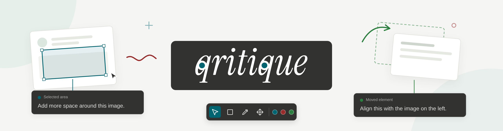

<p align="center">
  
</p>

<p align="center">
  A browser extension for visual feedback on websites.<br>
  Select areas, comment on them, and copy an annotated image and prompt.
</p>

<p align="center">
  <a href="#install">Install</a> ·
  <a href="#usage">Usage</a> ·
  <a href="#development">Development</a>
</p>

## What it does

- Mark areas with boxes, polygons, pencil strokes, or a brush.
- Group feedback by color or number and add a note to each group.
- Inspect page elements or move them to suggest layout changes.
- Copy an image cropped around your marks and a prompt, filtered to the feedback you want to share.

Feedback is stored locally per page. The extension does not use an account, analytics, or a server.

## Install

Qritique supports Chrome 116+ and Firefox 128+. To build it locally, you need Node.js 22.12+ and pnpm:

```sh
pnpm install
pnpm build:all
```

- **Chrome:** Open `chrome://extensions`, enable Developer mode, and load `.output/chrome-mv3` as an unpacked extension.
- **Firefox:** Open `about:debugging#/runtime/this-firefox` and load `.output/firefox-mv3/manifest.json` as a temporary add-on.

Run `pnpm zip` to create distributable ZIPs. Firefox installations outside temporary development require Mozilla signing.

## Usage

Click the extension icon or press **Alt+Shift+Q** to open qritique. Choose a tool and a color or number, mark the page, and add a note. Use the export menu to copy the image or notes; Shift-click **Copy image** to download a PNG.

| Action | Shortcut |
| --- | --- |
| Select / box / polygon | `V` / `R` / `L` |
| Pencil / brush | `P` / `B` |
| Inspect / move element | `I` / `M` |
| Annotate current group | `C` |
| Numbered notes | `N` |
| Undo / redo | `Ctrl` or `Cmd` + `Z` / `Shift` + `Z` |
| Copy image / notes | `Ctrl` or `Cmd` + `C` / `Shift` + `C` |
| Settings | `?` |

Images include the selected marks with 48 pixels of surrounding context. Distant sections are stacked in reading order with a small gap; overlapping sections are combined. Nearby marks share viewport screenshots, and unmarked gaps are skipped. Move annotations include both the original and proposed positions. Mark an area before exporting an image; notes can be copied without marks.

Capture briefly scrolls to the selected sections and restores your position afterward. Keep the annotated tab active during export. Pages that change while being captured may need another attempt.

Shortcuts can be changed in settings. Browser-internal and extension-store pages cannot be annotated.

## Development

```sh
pnpm dev             # Chrome extension
pnpm dev:firefox     # Firefox extension
pnpm dev:preview     # Standalone playground at localhost:5173
```

The playground supports annotations and notes; capturing a real website requires the extension.

```sh
pnpm lint
pnpm typecheck
pnpm test
pnpm exec playwright install chromium firefox
pnpm test:e2e
pnpm build:all
```

Built with React, TypeScript, and WXT. Git hooks are installed with dependencies; push checks run typechecking and tests.
